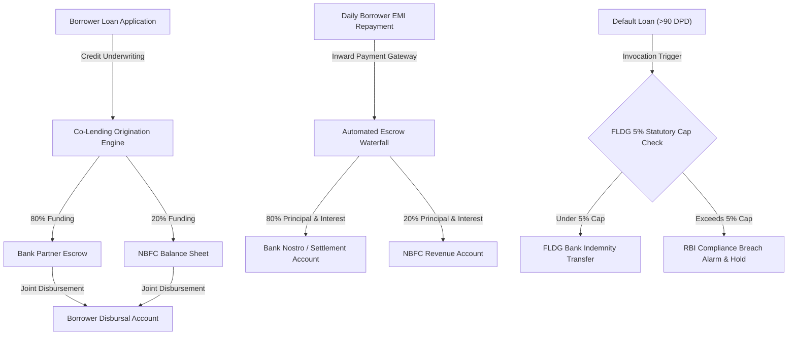

# Frappe NBFC Co-Lending & 5% FLDG Waterfall Engine

[](https://frappeframework.com/)
[]()
[]()
[](LICENSE)

## 📌 Executive Overview & Real-World Client Problem

Under the **Reserve Bank of India (RBI) Co-Lending Model (CLM-2)** and the **Default Loss Guarantee (DLG/FLDG) Guidelines of June 2023**:
1. Scheduled Commercial Banks and Fintech NBFCs co-originate priority sector loans under an **80:20 risk/profit split**.
2. NBFCs offering credit enhancement to bank partners are legally capped at **maximum 5% First Loss Default Guarantee (FLDG)** over the total outstanding loan portfolio.
3. Daily loan servicing requires an automated **escrow waterfall**: when the borrower pays an EMI, 80% of principal & interest must settle to the Bank's account, and 20% to the NBFC, with zero manual reconciliation lag.
4. Default management mandates that when an NPA crosses 90 DPD, FLDG invocation must be capped strictly to avoid central bank regulatory penalties.

This Frappe application delivers an institutional co-lending engine tailored for Indian banks and fintech lenders.

---

## 🏛️ System Architecture Flow



---

## 🚀 Key Engineering Capabilities

- **Automated 80:20 Loan Booking:** Splits borrower principal, calculates blended interest yields, and synchronizes loan master accounts.
- **Daily Escrow Waterfall Router:** Processes NACH/e-Mandate collections and immediately segregates bank vs NBFC shares with double-entry journal postings.
- **Strict 5% FLDG Guarantee Guard:** Tracks active FLDG guarantees, invoked default claims, and automatically blocks non-compliant default calls.
- **DPD & Delinquency Tracking:** Computes Day Past Due (DPD) buckets (SMA-0, SMA-1, SMA-2, NPA) according to RBI Master Directions.

---

## 📂 Frappe DocType Schema & Data Structure

```text
nbfc_co_lending/
├── nbfc_co_lending_core/
│   ├── doctype/
│   │   ├── co_lending_loan/
│   │   │   ├── co_lending_loan.json
│   │   │   ├── co_lending_loan.py
│   │   │   └── co_lending_loan.js
│   │   └── fldg_cover_contract/
│   │       └── fldg_cover_contract.json
│   └── workspace/
│       └── nbfc_co_lending_workspace/
│           └── nbfc_co_lending_workspace.json
```

---

## ⚡ Frappe Hooks & Whitelisted APIs

- **REST Endpoint:** `POST /api/method/nbfc_co_lending.api.book_co_lending_loan`
- **Whitelisted Method:** `@frappe.whitelist() def process_daily_emi_waterfall(loan_account_no, emi_amount_received, interest_component, principal_component)`
- **Hooks Event:** `daily_long` cron runs the portfolio DPD aging and FLDG utilization audit.

---

## 🛠️ Installation & Bench Setup

```bash
bench get-app https://github.com/shyampandey1104/frappe-nbfc-co-lending-fldg-engine
bench --site erp.yourdomain.com install-app nbfc_co_lending
bench --site erp.yourdomain.com migrate
python3 -m unittest discover tests
```

---

## 📄 License
MIT License. Designed for Banks, Tier-1 NBFCs, and Digital Lending Platforms.
